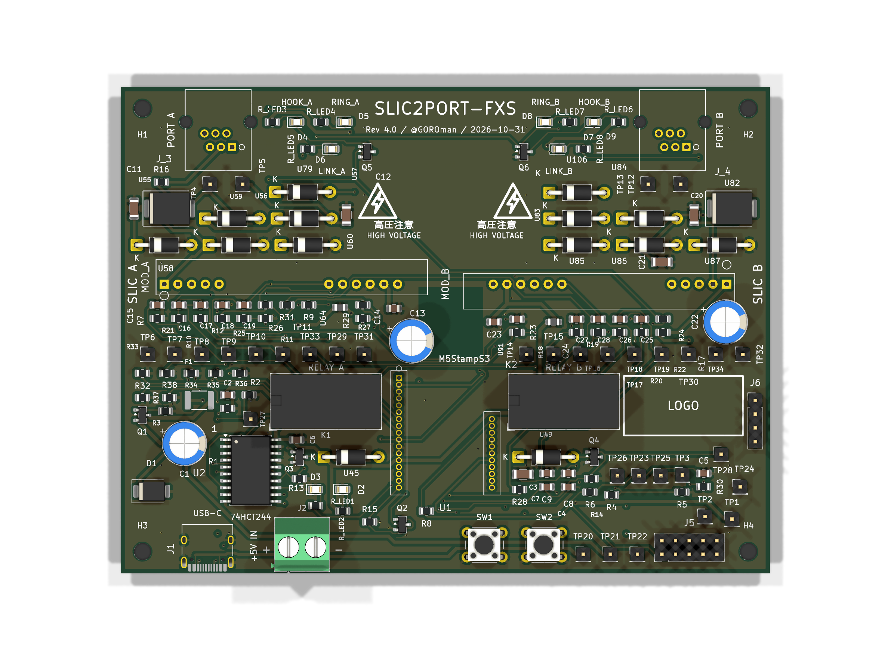
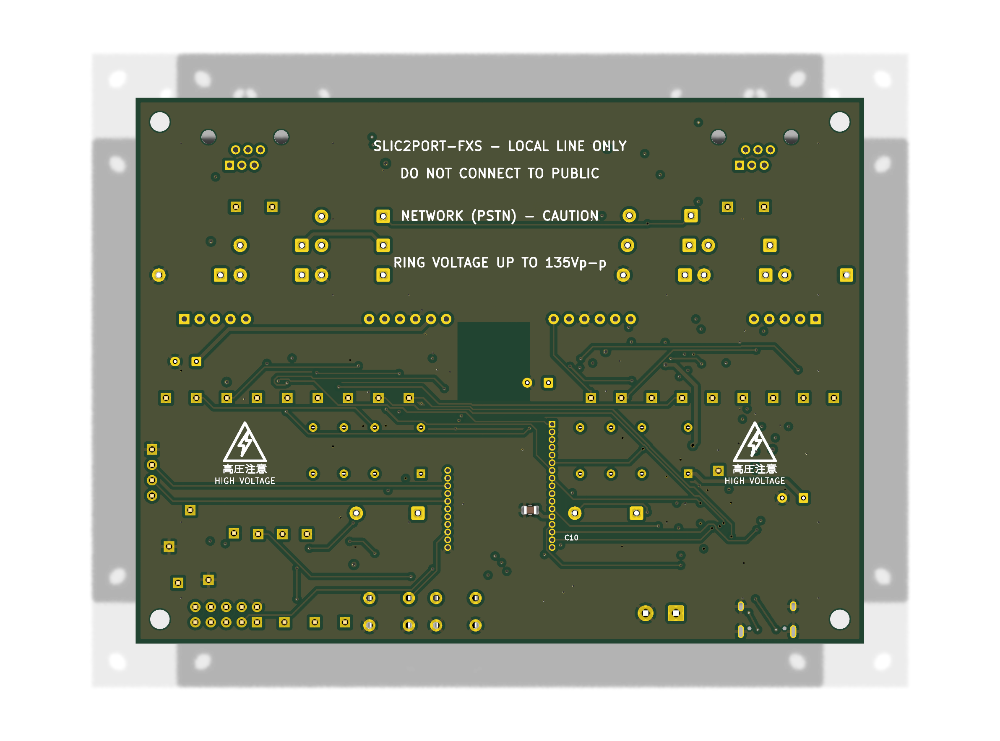
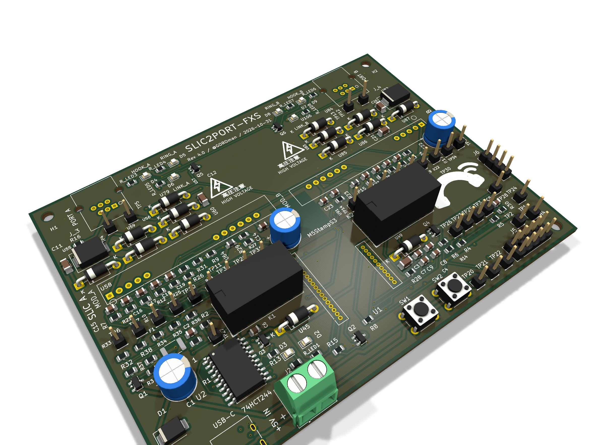

# m5stamp-slic-fxs — SLIC2PORT-FXS

**ステータス: 基板 v4.0（4層・全面再レイアウト・KiCad 配線済み）が最新。未発注。2026-10-31 時点**

**v4.0** は、v3.4.2 の電気的中身（回路・ネット・156 部品）をそのままに、配置を全面刷新して **4 層化**（F.Cu 信号 / In1.Cu GND プレーン / In2.Cu 信号 / B.Cu 信号）し、KiCad 上で配線まで完遂した版です。機能ブロック構成（ポート A/B を左右対称に、SLIC は自ポート近く、リレーは同一方向に整列、Stamp は中央＋アンテナキープアウト）で、FreeRouting + 手仕上げにより**未接続 0・短絡 0**。DRC の残件はフットプリント固有の裁定済み項目のみです。製造用 Gerber は KiCad 出力の一式を `gerber/` に同梱しています。**推奨ソルダーマスク色はマットブラック**（発注時に選択）。シルクにはタイトルブロック「SLIC2PORT-FXS Rev 4.0 / @GOROman / 2026-10-31」、大型部品の機能名ラベル、回線系エリアへの高圧警告マークを入れ、ロゴは決定後に差し替えできるよう配置スペースを確保しています。詳細は `kicad/CAD_REPORT.md` 第11ラウンド参照。

v3.4 は第7ラウンドの全数監査（物理干渉・シルク・ファームウェア整合・電気的妥当性・製造性・調達整合・極性）を通過して EasyEDA で配線した版（配線率 100%、トラック 1,514 本・ビア 179 本）、v3.4.1 は発注前チェック（Issue #9・#12）の是正版、v3.4.2 は RJ11 を秋月 100954（Neltron 7002-XPXC）のメーカー図面で全面是正し C13 のパッド干渉を解消した版です。各版の経緯は `kicad/CAD_REPORT.md` 第7〜第10ラウンドと Git 履歴を参照してください。v3.4 の EasyEDA 配線データ（`gerber/SLIC2PORT-FXS-v3.4.epro2` 等）は履歴として残しています。

## 概要

FAX機（Canon PIXUS MX923）と PC の FAXモデム（または2台目の FAX/電話機）を、公衆回線なしで直接 T.30 通信させるための、M5Stamp 制御の **2ポート疑似交換機（FXS 回線シミュレータ）** 基板の設計プロジェクト。

- SLICモジュール **KS0835F（Silvertel AG1171 系）×2** をソケット搭載し、各ポートが独立した加入者回線として振る舞う（回線電圧供給・リング送出/リングトリップ・オフフック検出）
- 制御は **M5StampS3（ESP32-S3）**：状態機械（発信/呼出/接続/解放）、ADC による音声モニタ＋DTMF（Goertzel）検出、トーン生成
- 音声のクロス接続は **Omron G5V-2 リレー×2**（DPDT）。無励磁（フェイルセーフ）で相手ポートと相互接続、励磁でトーンバスに切り替わる
- 信号レベルの不整合（SLIC 5V 系 ⇔ ESP32-S3 3.3V 系）は **74HCT244** のレベル変換と SHK 分圧で吸収
- ポートAに FAX機、ポートBにモデムを RJ11 で挿すだけで相互に発着信でき、T.30 ハンドシェイクがそのまま通る想定

## 基板プレビュー（v4.0・配線済み）

KiCad で全面再レイアウト・配線した v4.0 のレンダリングです。象限ズームは `docs/images/board-v40-crop-q1.png` 〜 `board-v40-crop-q4.png`。旧版（v3.4 配線済み・配置版ほか）も `docs/images/` に収蔵しています。

v3.4 までの歩み: v3.1 でパスコンを負荷近傍へ是正（C10 は U1 ソケット直下の裏面配置）、v3.2 で動作チェック用ステータス LED ×6 を追加、v3.3 で KiCad 標準の番号付きネット形式に是正（EasyEDA がネットを読めるようにする変換。経緯は CAD_REPORT 第6ラウンド）、v3.4 で全数監査の是正（端子台 J2 と U2 の物理干渉解消、シルク全数 225 テキストを干渉ゼロに再配置、RJ11 と Stamp ソケットの環状銅箔を JLCPCB 2層の製造下限以上に拡大、PD ダイオードを 1N5819 に変更、裏面警告文を移設）を行いました。その後 v3.4.1（発注前チェック是正）、v3.4.2（RJ11 の秋月 100954 実寸是正 + C13 のパッド干渉解消）を経て、v4.0 で全面再レイアウト + 4層化 + KiCad 配線を行いました。詳細は `kicad/CAD_REPORT.md` 第6〜第11ラウンド参照。

## 基板上の部品: 必須 / なくても動く

実装時の判断用に、基板上の部品を「ないと動かない（必須）」と「なくても動く（デバッグ・確認用／任意）」に分けました。部品番号は `bom.csv` / 基板 v3.4 のものです。

### 必須（ないと交換機として動かない）

| グループ | 部品 | 理由 |
|---|---|---|
| SLIC インターフェース | MOD_A, MOD_B（KS0835F）、RJ11 ジャック J_3, J_4 | 回線そのもの。TIP/RING の供給・リング送出・オフフック検出を担う |
| 制御・レベル変換 | U1（M5StampS3・ソケット実装）、U2（74HCT244） | 状態機械本体。HCT244 は F/R・RM・SEL・TONE を 5V フルスイングへ変換し、ないと SLIC の VIH を満たせない |
| SHK 取り込み | 10K/18K 分圧＋1nF（各ポート） | SHK 出力（約4.5V）を ESP32-S3 の入力範囲へ落とす。過電圧対策を兼ねる |
| 音声クロス接続 | K1, K2（G5V-2 リレー）、Q3, Q4（2N7002 ドライバ）、還流用 1N4007×2、ゲートプルダウン | VX/VR の相互接続とトーンバス切替。無励磁=クロス接続のフェイルセーフ構成 |
| 音声パス | 結合・バイアス用 100nF / 100K 群、0R（R20, R28: レベル調整用パッド、初期値 0Ω 実装） | VX/VR の AC 結合と VAUD バイアス。DTMF 受信用の ADC タップ（MON_x: 100nF＋100K＋10K＋1nF）もここに含まれ、ダイヤル検出に必須 |
| トーン生成 | LEDC 出力の RC ローパス（10K＋47nF ×2段）、47K 注入抵抗（R11）、100nF 直列結合 | ダイヤルトーン/呼出音/話中音（400Hz）をトーンバスへ注入する経路 |
| 電源 | J1（USB-C・CC 5.1K プルダウン含む）または J2（端子台）のいずれか一方＋両方実装が標準、F1（ポリヒューズ 2A）、Q1（AO3401A 逆接保護）、D1（SMBJ5.0A TVS）、C1（1000µF） | 5V 入力と保護。同時給電は禁止（どちらか一方から給電） |
| ポート電源 | フェライトビーズ U64, U91、C13, C22（470µF）、モジュール直近 100nF | AG1171 接続図指定のモジュール電源まわり。DC/DC ノイズのポート間回り込み防止 |
| 回線保護 | P3100SC（U55, U82）、保護ブリッジ 1N4007×8、BZT03C82（U60, U87）、27K CLI バイアス（R16, R24）、10nF/250V EMI コンデンサ（C11, C12, C20, C21） | いずれも AG1171 データシート指定の回線側構成。サージのクランプ（v3.4.1 でメーカー図の GND 基準クランプに是正）とオンフック時 DC 経路 |
| リセットプルダウン | 100K ×7（HCT244 の使用入力分）ほか信号プルダウン群 | ESP32 のリセット・書き込み中も RM/SEL/TONE/F/R を L に確定させるため |
| 基準電圧 | VAUD 分圧（4.7K×2＋10µF＋100nF）、VREF165 分圧（47K×2） | 音声バイアス（約2.5V）と ADC タップのバイアス（約1.65V） |
| パスコン | 各 IC・モジュール近傍の 100nF 群（C6, C10, C14, C23 ほか） | 発振・誤動作防止。配置は負荷近傍に最適化済み（v3.1/v3.4） |
| 操作ボタン | SW1（RST）, SW2（BOOT） | リセットと書き込みモード操作用。v3.4.1 で SW2 を移動し、パッド間隔 1.8mm を確保済み（v3.4 では接触していた。Issue #9） |

### なくても動く（未実装でも交換機として動作する）

| グループ | 部品 | 用途 |
|---|---|---|
| ステータス LED 群 | D2（電源）, D3（GPIO4 ステータス）, D4〜D9（HOOK/RING/LINK・ポート毎）と R_LED1〜R_LED8、HOOK 表示バッファ Q5, Q6（2N7002） | 通電状態と各ポートのオフフック/リング/リレー励磁を目視確認するための表示専用（DESIGN §5.7） |
| テストポイント | TP1〜TP34 | 主要信号の引き出しランド（ピンヘッダ兼用）。部品実体はない。TP4/TP5/TP12/TP13（TIP/RING）は高電圧注意 |
| PD 引き下げ回路 | 1N5819（U79, U106）、Q2（2N7002）と PD バスまわり | SLIC のパワーダウン用。デフォルトはオープン（常時起動）で、v1 ファームウェアでは未使用。回路だけ用意してある |
| デバッグ・拡張コネクタ | J6（UART_DBG）, J5（EXPANSION） | シリアルデバッグと将来拡張用 |

## 必要なパーツ（基板の外も含む）

### 必須

| パーツ | 備考 |
|---|---|
| 本基板（v4.0 を発注） | JLCPCB 想定、4層 1oz。ソルダーマスク色は**マットブラック推奨**（発注時に選択） |
| KS0835F モジュール ×2 | 標準バリアント（3.2〜5.5V・0dB）。ユーザ所有品から使用 |
| M5StampS3（または S3A）×1 | 基板側に 1.27mm ピッチ メスピンヘッダ 17P＋11P を実装し、Stamp 側キャスタレーションにオスピンを付けて差し込む（直接はんだ付けしない） |
| KS0835F 用ソケット/ピンヘッダ | モジュールもソケット実装（2.54mm ピッチ、ピン5–6間にギャップあり） |
| 5V/3A 電源 | 最悪消費 約1.5A の設計。USB 2.0 ポート給電では不足。通常の USB-C 5V アダプタか端子台から給電 |
| RJ11（6P6C・中央ペア結線）ケーブル ×2 | FAX機・モデムとの接続用。日本の 6極2芯コードも中央ペアなのでそのまま使える |
| 上記「必須」表の基板実装部品一式 | 詳細は `bom.csv`（調達先の型番メモは Note 欄） |

### オプション（あると良いもの）

| パーツ | 用途 |
|---|---|
| FAXモデム（USB/シリアル）または 2台目の FAX機・電話機 | ポートB 側の対向試験用。本命は Canon PIXUS MX923 との T.30 対向 |
| オシロスコープ / ロジックアナライザ | リング波形（20Hz・135Vp-p）と T.30 ハンドシェイクの観測。テストポイントが全信号分あるので効く |
| 3Dプリントケース | `enclosure/` に設計予定（現在設計中） |
| 秋月電子の簡易擬似電話交換機キット | 本基板なしでも FAX 同士を繋げる比較・切り分け用リグ |
| 予備の KS0835F モジュール | 故障切り分け用（所有 4 個のうち 2 個を本基板に使用） |
| ピンヘッダ（TP 用） | テストポイントに常設プローブ点を付けたい場合 |

## ファームウェア

- `firmware/m5stamp_fxs_exchange.ino`＋`firmware/platformio.ini`。PlatformIO（espressif32@7.0.1 固定）で `pio run -d firmware` の成功を確認済み。LEDC API は Arduino core 2.x/3.x 両対応の互換シム入り
- GitHub Actions の CI（regression＋firmware-build 実ビルド）は緑
- DTMF 受信は最短 40ms のトーンに対応（スライディングウィンドウ方式。要件は DESIGN §8.4、検証は Issue #7）
- リング試験後の誤発呼（Issue #5）、PlatformIO と Arduino API の不整合（#4）は修正済み。Issue #4〜#7 はいずれもクローズ

## ケース

3Dプリント用ケースは設計中です（`enclosure/` に配置予定）。基板 120×90mm・取付穴 4 点に合わせ、RJ11/USB-C/端子台の開口と LED 窓を持つ 2 ピース構成を想定しています。

## 内容物

| パス | 内容 |
|---|---|
| `DESIGN.md` | 設計書本体（ブロック図、電源・保護設計、GPIO 割り当て、音声クロス接続とトーンの定数設計、動作シーケンス、レイアウト指針、実物確認手順、DTMF 仕様 §8.4） |
| `bom.csv` | 部品表（156点・43グループ、ネットリストから生成。TP 34 点を含む） |
| `firmware/` | M5StampS3 用制御スケッチと PlatformIO 設定 |
| `kicad/` | SKiDL 回路定義（`skidl/`、ネットリスト含む）、自作フットプリント（KS0835F・RJ11・Stamp ソケット）、基板データ `SLIC2PORT-FXS.kicad_pcb`（v4.0・配線済み）、`CAD_REPORT.md`（設計・監査の記録）、`README_CAD.md` |
| `gerber/` | v4.0 の製造データ: `SLIC2PORT-FXS-v4.0-gerber-kicad.zip`（KiCad 出力の Gerber 一式）と個別ファイル一式。v3.4 の EasyEDA データ（`SLIC2PORT-FXS-v3.4-gerber-easyeda.zip`、`SLIC2PORT-FXS-v3.4.epro2`）も履歴として収蔵 |
| `docs/images/` | 基板レンダリング（配線済み v4.0: `board-v40-routed-{top,bottom,3d}.png`、象限ズーム `board-v40-crop-q1..q4.png`、旧版も収蔵） |
| `tests/` | ホスト回帰テスト（状態機械・DTMF・ハードウェア整合） |
| `research/` | 参照資料: AG1171 データシート、KS0835F データシート（PDF＋テキスト抽出） |
| レビュー記録 | 修正点・残課題は [`REVIEW.md`](REVIEW.md) と GitHub Issues を参照 |

## 発注前に必須の確認（設計書 §10）

- v4.0 の Gerber（`gerber/SLIC2PORT-FXS-v4.0-gerber-kicad.zip`）で発注すること。注文オプションは **4層**、ソルダーマスク色は**マットブラック推奨**
- 実物 KS0835F モジュールのバリアント刻印の確認
- モジュールのピン間隔（5ピン＋6ピンの2クラスタ、ピン5–6間ギャップ）のノギス実測 → フットプリントのパラメータ検証
- 実 RJ11（秋月 100954）現物で嵌合・ペグ入りを最終確認すること（フットプリントはメーカー図面で是正済み: 接点穴 ø0.90・位置決めペグ NPTH ø2.30 ×2）
- `enclosure/` の開口は v3.4 系の配置前提のため v4.0 のコネクタ位置には合わない。ケースを使う場合は enclosure 側の改修が必要

## 安全上の注意

- **公衆電話回線（PSTN）への接続は絶対禁止**。ローカル閉回線専用です（基板シルクにも明記）。
- リング時は回線に最大約 135Vp-p が出ます。感電に注意してください。
- 5.5V を超える無調整電源の直結は厳禁です（KS0835F の絶対最大定格）。

## 参考にした先行事例

- Silvertel AG1171 Datasheet／KS0835F Datasheet V1.3（`research/` に同梱）
- GitHub `diggydude/php-pbx`（KS0835F を使った電話交換機の実例）
- 秋月電子 簡易擬似電話交換機キット（リレー式通話路の構成を参考）
- M5Stack 公式ドキュメント・公式 GitHub `M5_Hardware`（Stamp-S3 のシンボル/フットプリント）
