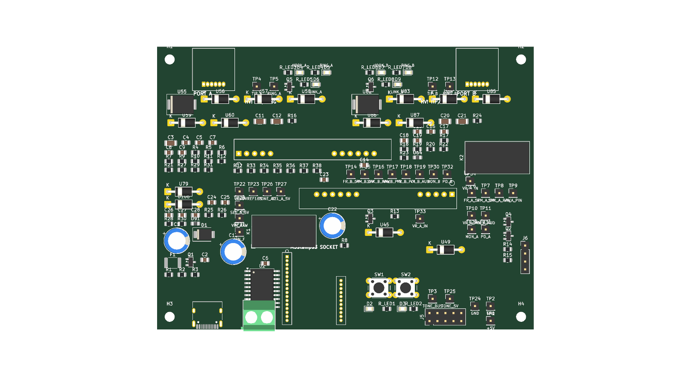
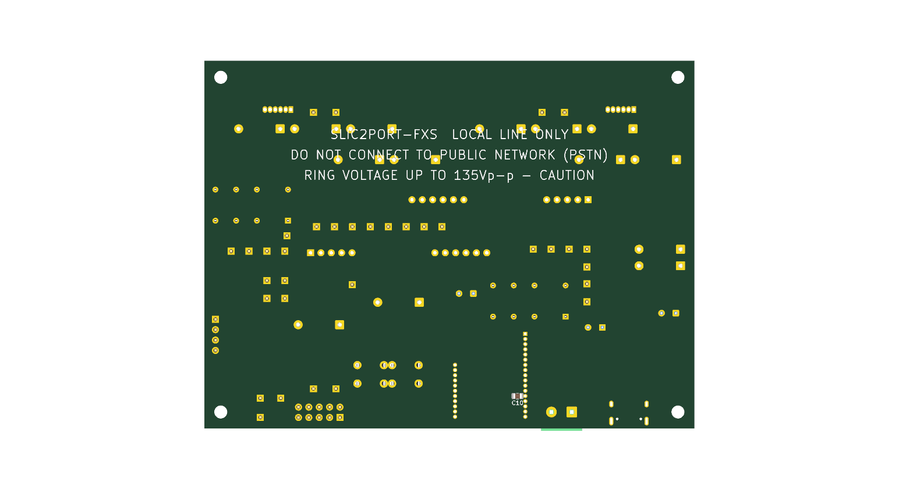

# m5stamp-slic-fxs — SLIC2PORT-FXS

**⚠ ステータス: 設計途中・未発注（2026-10-31 時点）**
配置済みの基板データ（`kicad/SLIC2PORT-FXS.kicad_pcb`、106部品・未配線）はあります。配線の仕上げは EasyEDA で行う予定で、ガーバー・発注はまだです。このリポジトリは設計パッケージの保管・共有用です。

## 概要

FAX機（Canon PIXUS MX923）と PC の FAXモデム（または2台目の FAX/電話機）を、公衆回線なしで直接 T.30 通信させるための、M5Stamp 制御の **2ポート疑似交換機（FXS 回線シミュレータ）** 基板の設計プロジェクト。

- SLICモジュール **KS0835F（Silvertel AG1171 系）×2** をソケット搭載し、各ポートが独立した加入者回線として振る舞う（回線電圧供給・リング送出/リングトリップ・オフフック検出）
- 制御は **M5StampS3（ESP32-S3）**：状態機械（発信/呼出/接続/解放）、ADC による音声モニタ＋DTMF（Goertzel）検出、トーン生成
- 音声は CD4053B アナログスイッチで2ポートの 4W 音声（VX/VR）をクロス接続
- ポートAに FAX機、ポートBにモデムを RJ11 で挿すだけで相互に発着信でき、T.30 ハンドシェイクがそのまま通る想定

## 基板プレビュー（v3.2・配置済み / 未配線）【PR レビュー中】

ネットリスト（156部品）から再生成した配置済み基板 `kicad/SLIC2PORT-FXS.kicad_pcb` の 3D レンダリング。v0.2 設計（G5V-2 リレー方式・テストポイント34点・M5StampS3 ソケット実装）を反映し、外形は 120×90mm。v3.1 でパスコンを負荷の近傍へ是正し（U2 の VCC 脇に C6、各モジュールの電源ピン脇に C14/C23、バルク C13/C22 を自ポート側へ、C10 は U1 ソケット直下の裏面に配置）、v3.2 で動作チェック用ステータス LED ×6（HOOK/RING/LINK、ポート毎、基板上端に配置。DESIGN §5.7）を追加した。配線はこのあと EasyEDA に取り込んで仕上げるため、現時点では未配線（銅箔パターンなし）。

## 内容物

| パス | 内容 |
|---|---|
| `DESIGN.md` | 設計書本体（ブロック図、電源・保護設計、GPIO割り当て、音声クロス接続の定数設計、動作シーケンス、レイアウト指針、実物確認手順） |
| `bom.csv` | 部品表（106点・40グループ、ネットリストから生成） |
| `firmware/m5stamp_fxs_exchange.ino` | M5StampS3 用制御スケッチ雛形（2ポート状態機械、未コンパイル・しきい値は実機調整前提） |
| `kicad/` | SKiDL 回路定義（`skidl/`、簡易 ERC と接続検査で生成したネットリスト含む）、M5Stack 公式シンボル/フットプリント、自作 KS0835F・RJ11 フットプリント、プロジェクト雛形、`README_CAD.md`（KiCad 仕上げ手順） |
| `research/` | 参照資料: AG1171 データシート、KS0835F データシート（PDF＋テキスト抽出） |

## 発注前に必須の確認（設計書 §10）

- 実物 KS0835F モジュールのバリアント刻印の確認
- モジュールのピン間隔（5ピン＋6ピンの2クラスタ、ピン5–6間ギャップ）のノギス実測 → フットプリントのパラメータ検証

## 安全上の注意

- **公衆電話回線（PSTN）への接続は絶対禁止**。ローカル閉回線専用です。
- リング時は回線に 120–135Vp-p が出ます。感電に注意してください。

## 参考にした先行事例

- Silvertel AG1171 Datasheet／KS0835F Datasheet V1.3（`research/` に同梱）
- GitHub `diggydude/php-pbx`（KS0835F を使った電話交換機の実例）
- M5Stack 公式ドキュメント・公式 GitHub `M5_Hardware`（Stamp-S3 のシンボル/フットプリント）

レビューでの修正点・残課題・検証コマンドは [`REVIEW.md`](REVIEW.md)、設計詳細は `DESIGN.md` を参照してください。
