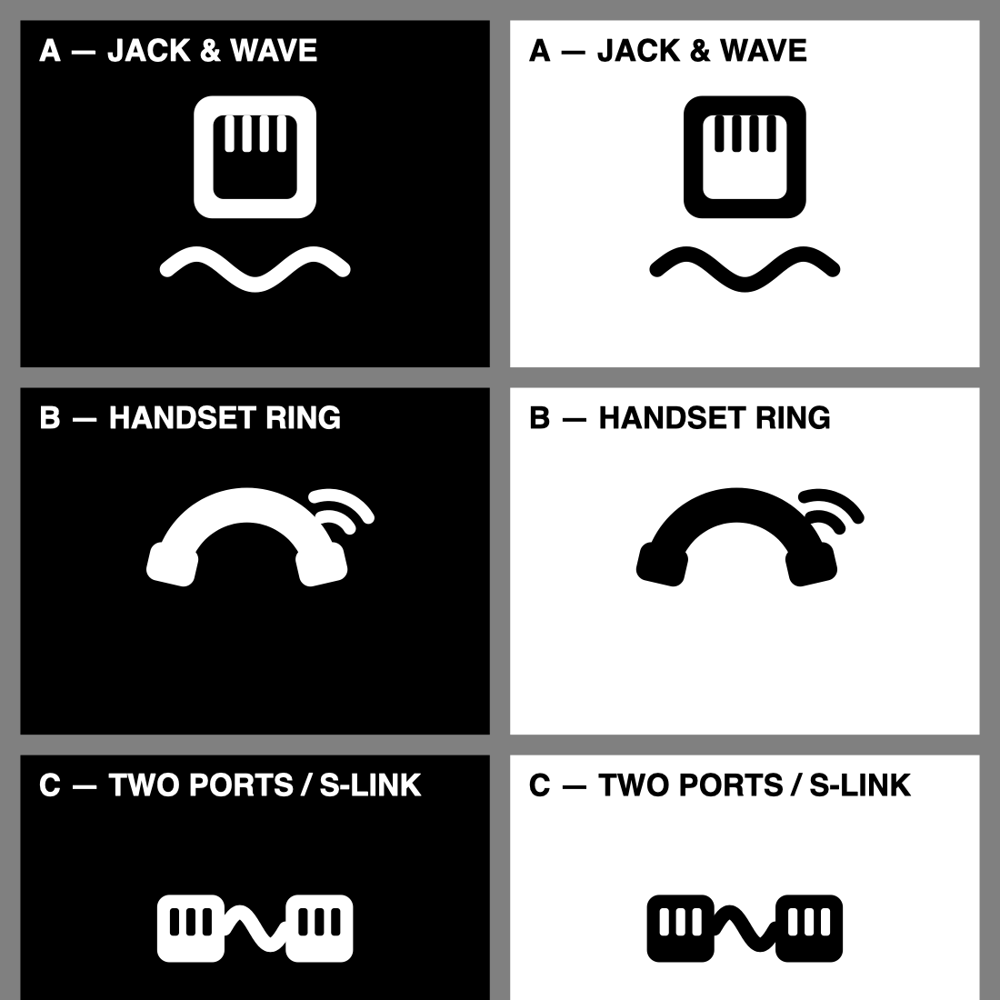

# SLIC2PORT-FXS ロゴ

基板シルク（白1色）・ケース刻印（エンボス）・README で共通使用するためのロゴ。
全案とも **単色ベクターのみ**（太い面と太い線だけで構成し、細線・階調・色分けに頼らない）で、
シルク印刷とエンボスの両方にそのまま流用できる形状にしている。

## ファイル

| ファイル | 内容 |
|---|---|
| `logo-a.svg` / `logo-b.svg` / `logo-c.svg` | マーク単体（透過背景・黒）。色は使用時に白へ反転可 |
| `logo-*-on-black.svg/.png` | 黒地に白のプレビュー（基板シルク想定） |
| `logo-*-on-white.svg/.png` | 白地に黒のプレビュー（ケース刻印・文書想定） |
| `logo-wordmark.svg` ほか | 推奨案A＋製品名のロックアップ（横組み） |
| `logo-compare.svg/.png` | 3案 × 黒地/白地の比較シート |
| `gen_logo.py` | 全SVGの生成スクリプト（形状は数値計算で生成。再生成: `python3 gen_logo.py`） |

## 3案

### 案A — JACK & WAVE（推奨）
RJ11 ジャックの正面（角丸の枠＋上部に垂れる4本の金接点）の下に、信号波形（正弦波）を置いた構成。

- 一目で「電話ポート＋信号」と読め、製品の機能（回線インターフェース）をそのまま表す
- 要素が大きく、小サイズ（基板シルク 8〜10 mm 級）でも接点と波形が潰れず判別できる
- 幾何学性が高く、基板上の他シルク（部品名ラベル等）と並べても統一感が出る
- ワードマークと横組みしたときの収まりが最も良い（`logo-wordmark.svg`）

### 案B — HANDSET RING
受話器（円弧＋両端の受話/送話ブロック）に呼び出し音の波紋を付けた構成。

- 「電話」そのものの直感性は3案中いちばん強い。FAX/電話機と並ぶ文脈では分かりやすい
- ただし受話器は汎用アイコンとしても多用される形で、製品固有の識別性はA/Cより弱い
- 曲線主体のため、エンボス化した際の立体感は良い

### 案C — TWO PORTS / S-LINK
モジュラー形状のポート2個を、S字の波形でつないだ構成。

- 「2ポートを相互接続する」という本機固有の機能（FXS同士の直結）を最も正確に表す
- ポート面のスリットが小さい要素で、極小サイズでは A より判別性が落ちる
- 横長構図のため、基板の空きスペース形状によっては A のほうが収まりが良い場面がある

## 推奨

**案A を推奨する。** 理由は (1) 小サイズでの判別性が最も高く、基板シルクの実使用条件に合う、
(2) 「ジャック＋波形」で電話回線と信号処理の両方を表せる、(3) ワードマーク併記時のバランスが良い、の3点。
製品の「2ポート接続」という個性を優先するなら案C が対抗馬。

最終選定はユーザーが行う。本メモは選定材料であり、未選定の案も削除せず残す。

## 選定結果

**2026-10-31、ユーザーが案B（HANDSET RING）を選定した。**

- 基板シルク: v4.0 の仮置きロゴを `logo-b.svg` 由来のシルク図形へ差し替え済み（幅 21 mm、基板中心 (104, 59.9) 付近）
- ケース刻印: 蓋へ案Bロゴを追加（enclosure/enclosure.scad）
- 未選定の案A・案C は本メモのとおり残置する（削除しない）

## 使用ガイド

- **色**: 単色前提。基板シルクは白、ケース刻印は凹凸のみ（色なし）、文書では黒または白抜き。
- **最小サイズ目安**: シルク印刷は幅 8 mm 以上、ケース刻印は幅 15 mm 以上を推奨。
  最細要素は 240 グリッド上の 12〜15 ユニット（幅 8 mm 時で約 0.4〜0.5 mm）で、
  一般的なシルク最小線幅（0.15 mm 級）を十分上回る。
- **ワードマークの文字**: Helvetica / Arial Bold のライブテキスト。製造データ化する際は
  必ずアウトライン化すること（フォント環境差で字形が変わるため）。
- **余白**: マーク周囲にマーク幅の 1/6 以上のクリアスペースを確保する。
- **禁止事項**: グラデーション付与、ドロップシャドウ、要素の部分的な色替え、縦横比の変更。
