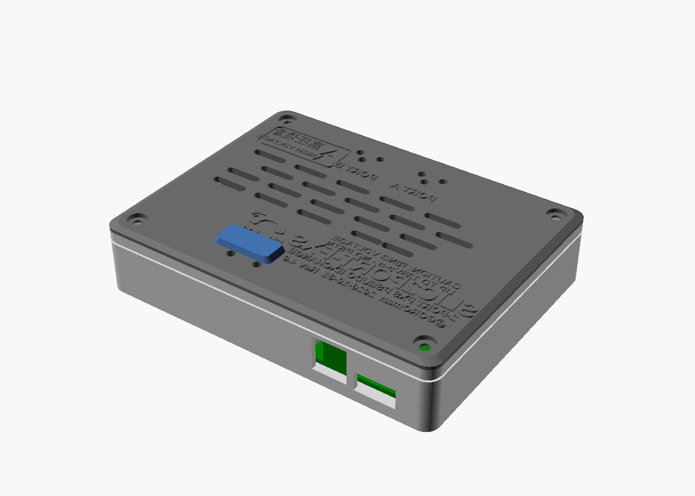
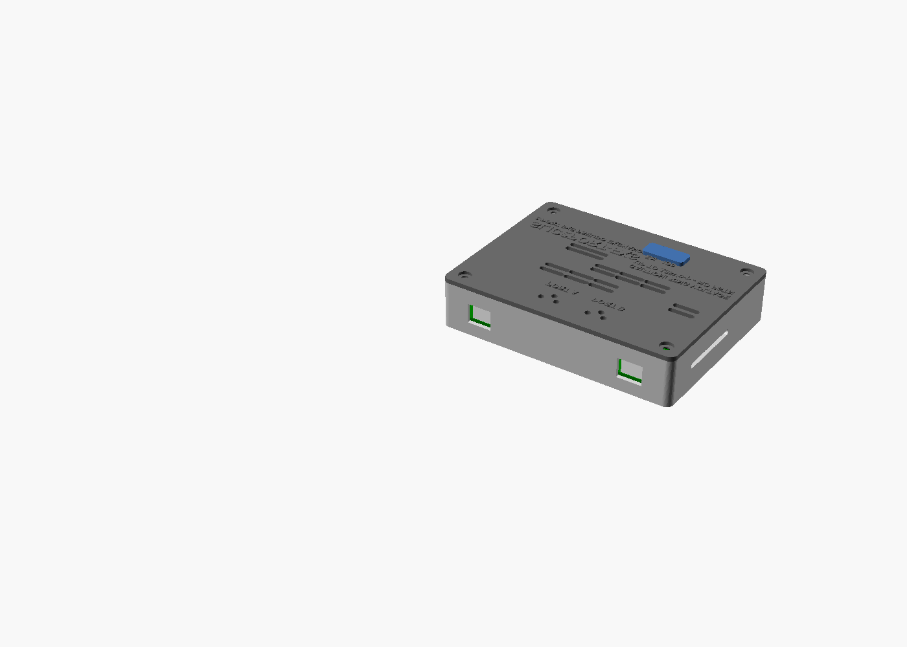
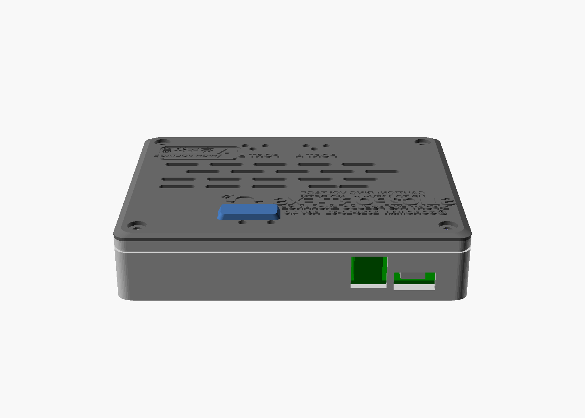
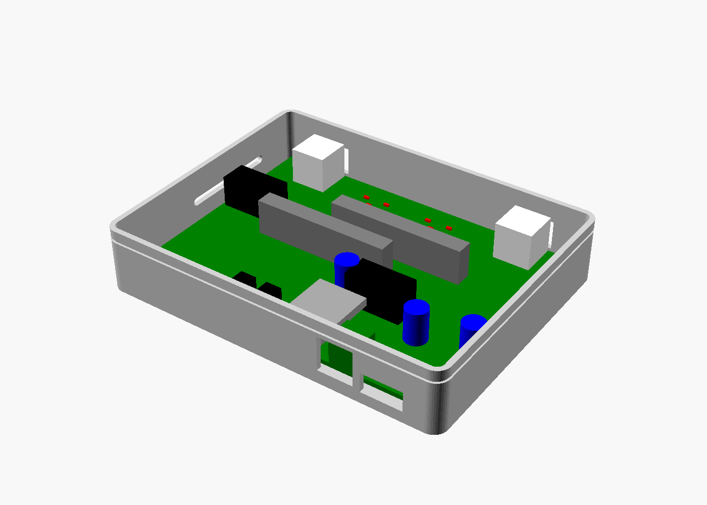

# SLIC2PORT-FXS 専用ケース (3Dプリント用)

SLIC2PORT-FXS 基板 (120×90mm) を収める 2ピース構成の FDM 印刷用ケースです。
寸法は v3.4 で抽出し、v3.4.1 (現行) でも全寸法を再照合済みです (差分は SW2 の +1.8 mm 移動のみ)。
ベース + 蓋 + ボタン押し子 (プランジャ) の 3 点で構成します。






## ファイル

| ファイル | 内容 |
|---|---|
| `enclosure.scad` | パラメトリック設計ソース (OpenSCAD)。`part` 変数で base / lid / plungers / assembly / open を切替 |
| `slic2port-base.stl` | ベース (基板支持ボス・コネクタ開口・通気) |
| `slic2port-lid.stl` | 蓋 (LED 窓・ボタン穴・通気スリット・浮き出し文字) |
| `slic2port-plungers.stl` | SW1/SW2 用の押し子 (2ボタン連結バー型、1 個) |
| `renders/` | プレビューレンダリング (基板・部品は寸法モック) |

再生成:

```sh
for p in base lid plungers; do
  openscad -D part=\"$p\" -o slic2port-$p.stl enclosure.scad
done
```

## 寸法根拠 (すべて実データから抽出)

基板ファイル `kicad/SLIC2PORT-FXS.kicad_pcb` (v3.4 / v3.4.1) をパースして抽出した値です。

| 項目 | 値 | 出典 |
|---|---|---|
| 基板外形 | 120.0 × 90.0 mm、板厚 1.6 mm (前提) | Edge.Cuts 外形 |
| 取付穴 H1〜H4 | (4, 4), (116, 4), (4, 86), (116, 86) mm、φ3.2 (M3) | MountingHole_3.2mm_M3 ×4 |
| RJ11 J_3 / J_4 | 本体中心 x = 18 / 102、前面は基板端から 0.45 mm 内側、本体 13.5×13.5 mm | RJ11_6P6C_TH シルク外形 |
| USB-C J1 | 中心 x = 16、シェル前面は基板端から 1.45 mm 内側、シェル 8.9 幅 × 3.3 高 | 基板パッド配置 + 第6ラウンド実測 |
| 端子台 J2 | ピン x = 30 / 35 (中心 32.5)、前面は基板南端付近 | MKDS-1,5-2 フットプリント |
| SW1 / SW2 | アクチュエータ中心 (70.78, 76.78) / (81.08, 76.78)、中心間隔 10.3 mm (SW2 は v3.4.1 で +1.8 mm 移動、Issue #9) | パッド重心 |
| LED D4〜D9 | (45.51, 8.18), (54.10, 8.18), (50.70, 11.97), (71.50, 8.18), (80.11, 8.18), (76.70, 11.97) | 基板配置 |
| LED D2 / D3 | (67.70, 83.47), (78.20, 83.47) | 基板配置 |
| SLIC モジュール | 外形 50.2 × 13.0 mm の縦型プレート、厚さ 6.3 mm、ピンは基板下 3.0 mm | KS0835F データシート p.9 |

### 高さ予算 (基板上面からの高さ)

| 部品 | 高さ | 根拠 |
|---|---|---|
| **KS0835F モジュール** | **約 15.5 mm (最背)** | ピン立上り約 2.4 + プレート 13.0 |
| RJ11 ジャック | 約 13.5 mm | 汎用 6P6C TH ジャックの代表値 (要実物確認) |
| 電解コンデンサ C1/C13/C22 | 約 12 mm | CP_Radial_D8.0 (Ø8 缶、代表値 12 mm) |
| リレー K1/K2 (G5V-2) | 11.5 mm | Omron データシート (20.5×10.1×11.5) |
| ピンヘッダ J5/J6/TP 群 | 約 11 mm | 2.54mm ヘッダ (ピン 8.5 + 台 2.5) |
| Stamp S3 (ソケット込み) | 約 7.5〜11.5 mm | ヘッダ 4.3〜8.5 + モジュール約 3 |
| 端子台 J2 | 約 10 mm | MKDS-1,5 代表値 |
| USB-C J1 | 約 3.3 mm | シェル高 |

→ 内面クリア高さは **18.0 mm** (最背部品に約 2.5 mm の余裕)。
基板裏面は C10 (0805、約 1 mm) + スルーホールピンの突出 (約 2 mm) を見て **3.5 mm** を確保。

### ケース寸法

- 外形: **128 × 98 × 27.5 mm** (蓋の浮き出し文字 +0.6 mm、押し子バー +2.2 mm)
- 壁厚 2.0 mm、底板 2.0 mm、蓋板 2.4 mm、基板と壁の間隔 2.0 mm
- Z スタック: 底板 2.0 + 裏面空間 3.5 + 基板 1.6 + 部品空間 18.0 + 蓋 2.4 = 27.5 mm

## 設計判断と理由

- **固定方式**: 蓋・基板・ベースを M3 ネジ 4 本で共締めします。ネジは蓋の穴 → 基板の取付穴
  (H1〜H4) → ベースのボス (φ2.9 の下穴、自己タップ) を貫通します。専用ボスを別に設けないので
  ケース外形を基板ギリギリに抑えられ、かつ蓋は工具なしでは外れません
  (リング電圧 最大 135Vp-p を扱う基板のための安全要件)。ヒートセットインサートを使う場合は
  `boss_hole_d = 4.3` に変更してください。ネジは **M3×26 なべ頭** (×25 でも可)。
- **RJ11 開口 (北面)**: ジャック前面はケース外面から 4.45 mm 奥まります (壁 2 + 間隔 2 + 0.45)。
  開口はプラグ+ラッチが通る 13.5 × 10.6 mm。RJ11 プラグのノーズ長は十分あるため挿抜に問題ありません。
- **USB-C 開口 (南面)**: シェル前面がケース外面から 5.45 mm 奥まるため、通常サイズの開口では
  プラグのオーバーモールドが壁に当たってシェルが届きません。そのため開口を **15 × 7.2 mm** に
  広げ、一般的なオーバーモールド (幅 14 mm・厚さ 7 mm 以下) がケース内に進入して完全嵌合できる
  ようにしています。太いオーバーモールドのケーブルは使えません。
- **端子台 J2 開口 (南面)**: 13 × 12.8 mm のスロット。配線作業は蓋を外して行い、
  蓋を閉めた状態で電線 (2 芯で φ5 mm 程度まで) が出入りできます。
- **LED 窓**: 蓋に φ3.2 mm の貫通穴を 8 個 (D4〜D9 + D2/D3)。0805 の上面発光 LED が
  そのまま覗く最も単純な方式で、追加部品は不要です。ラベルは蓋の浮き出し文字
  (PORT A / PORT B) と基板シルクで対応します。光を拡散させたい場合は穴に透明フィラメントの
  ピンを差すか、クリアレジンを 1 滴落とすと改善します。
- **ボタン押し子**: SW1/SW2 の中心間隔は 10.3 mm で、独立した押し子 (フランジ φ11) では
  フランジ同士が干渉するため、2 本シャフトの**連結バー型** (23×10 mm) にしました。シャフト φ6.4 / 蓋穴 φ7.0、
  静止時にボタン上面から 1.2 mm 浮いています。押し子は緩合で蓋に載っているだけなので、
  紛失防止に注意してください (予備印刷推奨)。
  **注意**: `button_h = 5.0` は SW_PUSH_6mm の代表高さです。6mm タクトスイッチには
  4.3 / 6 / 7 / 8 / 9.5 mm 等のバリエーションがあるため、実装するスイッチの高さが違う場合は
  パラメータを変更して再生成してください。
- **放熱**: 発熱源はリング送出時の SLIC モジュール 2 個とリレーです。蓋上面にモジュール直上と
  リレー直上へスリット (14×3 / 12×3)、側壁に各 3 本、底板に φ6 × 6 の吸気穴を開け、
  煙突効果で自然対流させます。
- **文字**: 蓋上面に製品名と "CAUTION: RING VOLTAGE / UP TO 135Vp-p - NO PSTN" を
  0.6 mm の浮き出しで入れました。向きは基板シルクと同じ (RJ11 側を奥に置いたときに読める) です。

## 印刷ガイド (Bambu 系想定)

| 項目 | 推奨 |
|---|---|
| 材料 | **PETG** (SLIC の発熱と耐久性のため。PLA でも当面可) |
| ノズル | 0.4 mm |
| レイヤー | 0.2 mm |
| ウォール | 4 本 |
| インフィル | 20〜25% (Gyroid) |
| サポート | **不要** (全パーツ)。壁の開口は最大 15 mm のブリッジで処理します |

配置方向:

- **ベース**: 底面を下にしてそのまま (開口上辺はブリッジになります)
- **蓋**: 上面を上にして配置 (浮き出し文字が綺麗に出ます)
- **押し子**: バーを下、シャフトを上にして配置 (同梱 STL はその向きになっています)

フィラメント量の目安 (メッシュ体積からの換算):

| パーツ | メッシュ体積 (ソリッド) | 印刷時目安 (PETG) |
|---|---|---|
| ベース | 43.6 cm³ | 約 35〜40 g |
| 蓋 | 28.1 cm³ | 約 25〜30 g |
| 押し子 | 1.4 cm³ | 約 2 g |
| 合計 | 73.0 cm³ | **約 65〜75 g** (サポートなし、ブリム含まず) |

印刷時間はプロファイル依存ですが、合計で数時間オーダーが目安です。

## 組み立て

1. 基板をベースに載せます (ボス 4 個に取付穴を合わせる)。コネクタ面の向きに注意。
2. RJ11 ×2 と USB-C ケーブルは蓋を付ける前後どちらでも挿せます。
3. 電源線は蓋を外した状態で J2 に配線し、スロットから引き出します。
4. 押し子バーを蓋のボタン穴 (EN / IO0) に載せます。
5. 蓋を被せ、M3×26 ×4 で締めます (締めすぎ注意。ボスは自己タップです)。
6. J5 / J6 / テストポイントはデバッグ用ヘッダのためケース開口はありません。
   測定時は蓋を外してください。

## 未検証事項 (実印刷・実機合わせ前の注意)

- 本ケースは **まだ実印刷していません**。寸法は基板ファイルとデータシートからの
  設計値で、実物合わせは未実施です。
- RJ11 ジャックは汎用フットプリント (13.5×13.5 mm 前提) です。実際に使うジャックの
  本体寸法・前面位置が異なる場合は開口が合いません (フットプリント自体にも
  "VERIFY against actual part" と明記されています)。明日到着する実ジャックで要確認。
- KS0835F の高さはデータシート図面 (ピン 3.0 + プレート 13.0) からの推定です。
  実物モジュールの全高実測で裏取りしてください。
- スイッチ高さ (`button_h`) は上記の通りバリエーション依存です。
